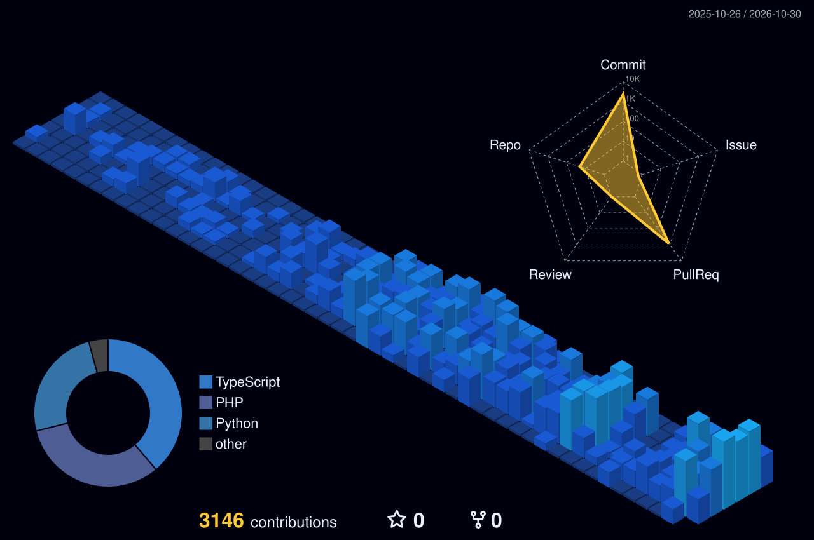

  

  

  
  
  
  

---

<table>
<tr>
<td width="52%" valign="top">

### Agora

Software Engineer na **Vector FIDC**, responsável pela plataforma interna de operações do fundo, do back-end ao front-end, com **FastAPI** e **React + TypeScript**.

Integro o sistema de gestão de crédito (**SQL Server**) a uma base própria em **PostgreSQL** para entregar a central de operações em tempo real, dashboards para a diretoria, a confirmação de títulos e automações de e-mail e **n8n**.

### Foco

APIs bem modeladas, integração entre sistemas legados e produtos de dados para quem decide no dia a dia do crédito.

</td>
<td width="48%" valign="top">

<picture>
  <source media="(prefers-color-scheme: dark)" srcset="./profile-3d-contrib/profile-night-view.svg" />
  <source media="(prefers-color-scheme: light)" srcset="./profile-3d-contrib/profile-gitblock.svg" />
  
</picture>

</td>
</tr>
</table>

### Tecnologias

  

### O que venho construindo

Os repositórios são privados. Um resumo do que está em desenvolvimento:

| Projeto | O que é | Stack |
|---|---|---|
| **Vector Automations** | Plataforma interna da Vector FIDC: central de operações ao vivo, dashboards da diretoria, confirmação de títulos e automações integradas ao sistema de crédito |     |
| **Tranche AI** | Hub de automações com IA para FIDCs, securitizadoras e factorings: análise de balanço e DRE, risco, faturamento e calculadora de borderô |    |
| **NaParty** | Convites e organização de eventos por link: confirmação de presença, enquete de data e vaquinha via Pix |    |
| **Meu Santo Cabide** | E-commerce completo, da API à infraestrutura com Docker e Nginx |    |

  

